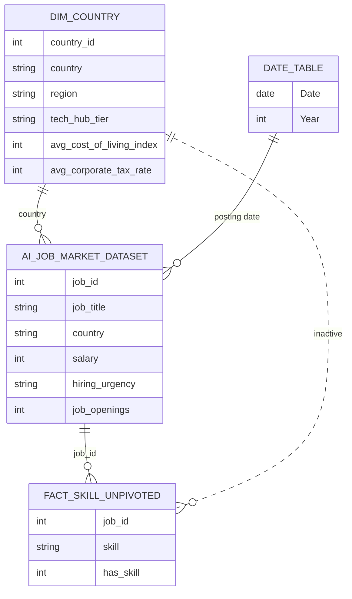
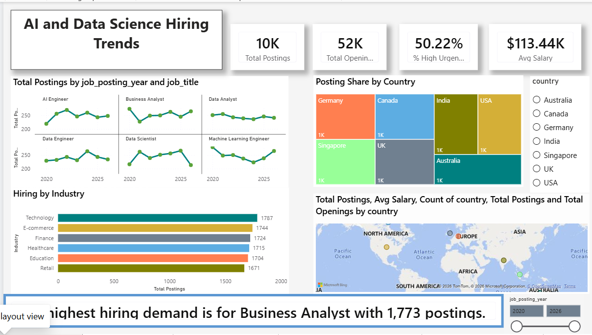
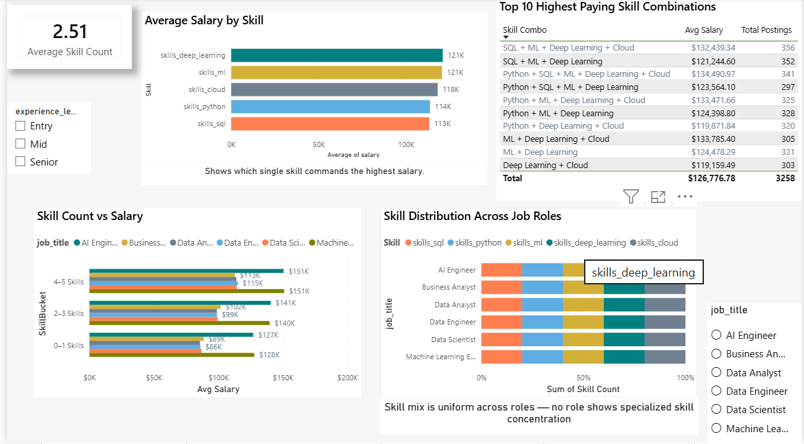
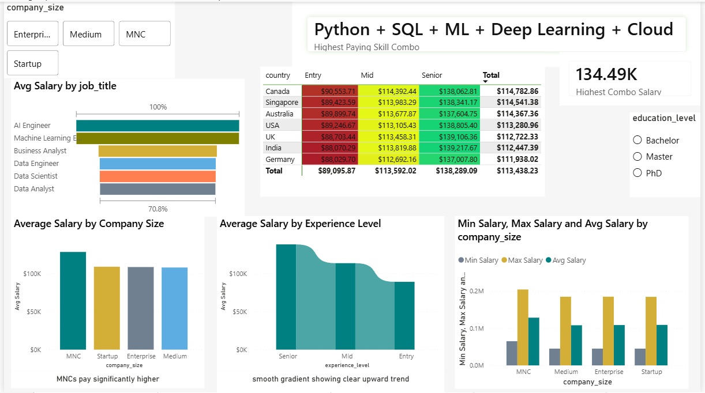
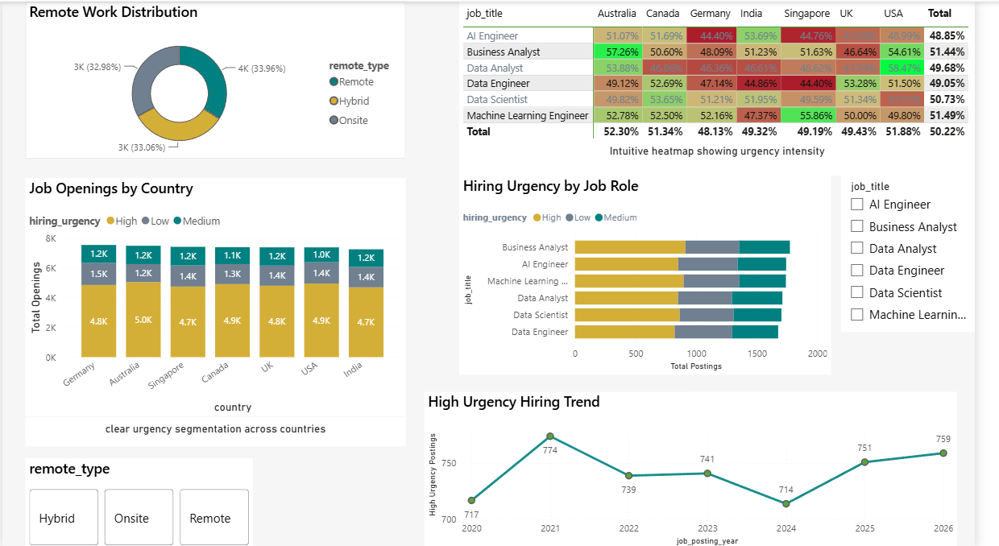
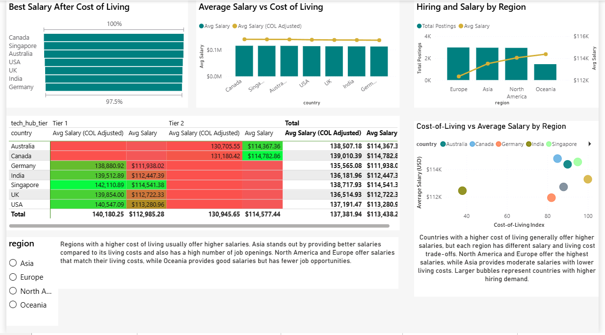
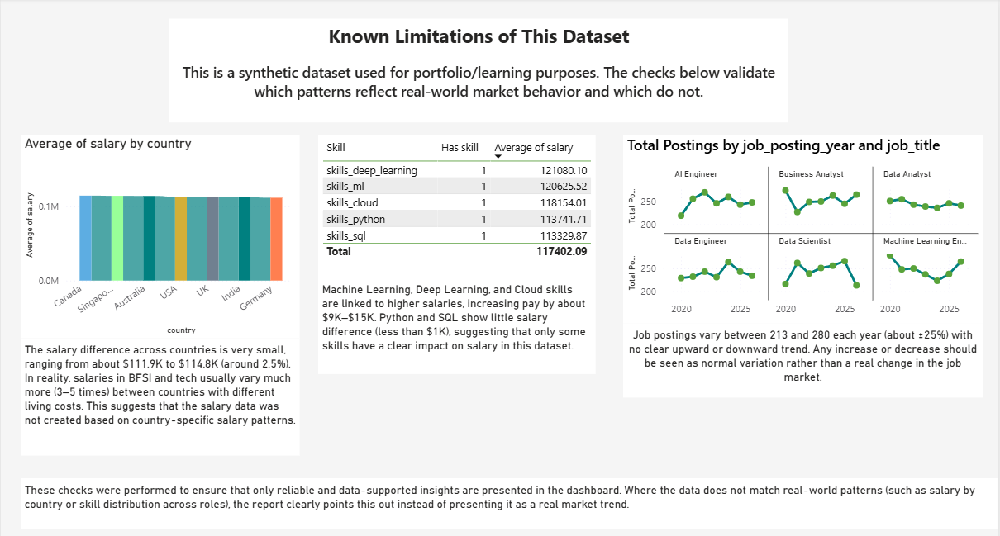

# AI & Data Science Hiring Trends: Power BI Dashboard

An interactive six-page Power BI report analysing **10,345 AI and Data Science job postings (2020–2026)**. It covers hiring trends, skill-based salary premiums, hiring urgency and regional pay, and it includes a dedicated **data validation page** that tests which patterns are trustworthy.

> **Important:** the source dataset is **synthetic** (built for learning and portfolio use). This project therefore treats *statistical rigour* as part of the deliverable: some patterns are reported as robust findings, and others are explicitly flagged as noise. See [Key Findings](#key-findings) and [Data Validation and Limitations](#data-validation-and-limitations).

---

## 1. Business Problem

Which roles, skills, company types and experience levels are associated with higher pay in AI and Data Science, and which apparent trends are actually just noise?

## 2. Snapshot

| Item | Detail |
|---|---|
| Tool | Power BI Desktop (Power Query, DAX, data modelling) |
| Rows | 10,345 job postings, 51,767 total openings |
| Period | 2020–2026 |
| Countries | 7 (Australia, Canada, Germany, India, Singapore, UK, USA) |
| Roles | 6 (AI Engineer, Business Analyst, Data Analyst, Data Engineer, Data Scientist, Machine Learning Engineer) |
| Average salary | $113,438 |
| High-urgency postings | 50.22% |
| Report pages | 6 |

## 3. Data Sources

| Source | Description | Licence |
|---|---|---|
| **AI & Data Science Job Market Dataset (2020–2026)** by shree0910, [Kaggle](https://www.kaggle.com/datasets/shree0910/ai-and-data-science-job-market-dataset-20202026) | Main dataset: one row per job posting, with salary, skills, urgency, and so on | CC BY-NC-SA 4.0 |
| `dim_country` (this repository) | Small reference table: region, tech hub tier, cost-of-living index, corporate tax rate, timezone group | See note below |

> **Reference table note:** `dim_country` is an **illustrative reference table compiled with AI assistance using approximate values**. It is not sourced from an official index, so cost-of-living-adjusted results are **indicative only**. Planned improvement: replace it with a published index (for example Numbeo or World Bank data) and cite it.

Column definitions are in [`docs/data_dictionary.md`](docs/data_dictionary.md).

## 4. Data Model

The model uses one main fact table (one row per posting), a country dimension, a date table, and a second skill-level fact table (one row per posting per skill) for skill analysis.



Original Model view from Power BI: [`docs/data_model.png`](docs/data_model.png)

**Data preparation (Power Query):** promoted headers, set data types, added a posting-date column from year and month, renamed columns, and built an unpivoted skill table.

## 5. Dashboard Pages

### Page 1: Overview
Headline KPIs (total postings, openings, % high urgency, average salary), postings trend by role, country share, hiring by industry, and a map. A dynamic DAX text measure states the top hiring role.



### Page 2: Skill Premium Story
Which skills, and how many, are linked to higher salaries.



### Page 3: Salary & Compensation Story
Salary by role, experience level, company size, and a country by experience heatmap.



### Page 4: Urgency & Opportunity
Hiring urgency by country and role, remote-work split, and the high-urgency trend over time.



### Page 5: Beyond the Paycheck
Cost-of-living-adjusted salary and regional comparison. **Known issue: see [Known Issues and Roadmap](#known-issues-and-roadmap).**



### Page 6: Data Validation & Limitations
Checks that separate real signal from synthetic-data noise.



## 6. Key Findings

Figures below were verified directly against the raw CSV.

### Robust patterns (clear, consistent effects)

| Driver | Finding |
|---|---|
| **Experience level** | Entry $89.1K, Mid $113.6K, Senior $138.3K (Senior earns about 55% more than Entry) |
| **Role** | AI Engineer ($139.9K) and Machine Learning Engineer ($139.7K) earn about 40% more than the other four roles ($99K–$102K) |
| **Company size** | MNCs average $128.3K, against $107.9K–$108.9K for Startup, Medium and Enterprise |
| **Skills** | Deep Learning (+$15.2K), Machine Learning (+$14.6K) and Cloud (+$9.7K) are linked to higher salary |
| **Skill count** | 0–1 skills average $100.6K, 2–3 skills $113.2K, 4–5 skills $126.6K |
| **Best skill combination** | Python + SQL + ML + Deep Learning + Cloud, at $134.49K (341 postings) |

### Patterns not supported by the data (treated as noise)

| Pattern | Why it is not a finding |
|---|---|
| Salary by country | Only a 2.5% spread ($111.9K–$114.8K); real markets differ several-fold |
| Python and SQL premium | Less than $1K difference between postings with and without the skill |
| Yearly posting trend | Total postings stay between 1,454 and 1,502 per year; per role per year they vary between 213 and 279 |
| Skill mix by role | Every role has an almost identical skill distribution |
| Remote / Hybrid / Onsite | Roughly one third each, with no salary difference |

## 7. Key DAX Measures

Every measure and calculated column is documented, with the reasoning, in [`docs/dax_measures.md`](docs/dax_measures.md). Highlights:

- `% High Urgency`: share of postings marked High, using `CALCULATE` and `DIVIDE`
- `Skill Combo` and `SkillBucket`: calculated columns that turn five skill flags into readable groups
- `Highest Paying Skill Combo`: uses `TOPN` and `SUMMARIZE` to find the best-paying combination dynamically
- `Top Hiring Role`: a dynamic text insight that updates with the filters
- `Avg Salary (COL Adjusted)`: salary divided by the cost-of-living index (see Known Issues)

## 8. Data Validation and Limitations

- The dataset is **synthetic**, so country-level salary and yearly trends should not be read as real market behaviour.
- `years_experience` shows **no relationship** with `experience_level` (average years is about 6.9–7.0 for Entry, Mid and Senior) or with salary (correlation about -0.01). The report therefore uses `experience_level`, not years, for analysis.
- No missing values or duplicate rows were found in the raw file.
- `dim_country` is an AI-assisted illustrative table (see [Data Sources](#3-data-sources)).

## 9. Known Issues and Roadmap

This project is shared as a work in progress. Known issues and planned fixes:

| # | Issue | Planned fix |
|---|---|---|
| 1 | **Page 5: the cost-of-living-adjusted salary is averaged per tech-hub tier instead of per country.** The visuals use the country column from the fact table, which does not filter `dim_country` because of the relationship direction. With the correct per-country index, India would rank first, not Canada or Singapore | Use `dim_country[country]` in the visuals and re-verify the page |
| 2 | Page 2 table titled "Top 10 Highest Paying Skill Combinations" is sorted by combination name, not by salary | Sort by average salary descending, or rename the table |
| 3 | `dim_country` values are approximate and AI-assisted | Replace with a published cost-of-living index and cite it |
| 4 | The skill fact table repeats several descriptive columns | Keep only `job_id`, skill and `Has skill` |
| 5 | `YoY Postings Growth` measure is defined but not shown on any page | Use it or remove it |
| 6 | `Posting dates` column is typed as "Any" | Change the data type to Date |
| 7 | Overview page: one KPI label and the insight text box are truncated | Widen the visuals |

## 10. How to Open the Dashboard

1. Install [Power BI Desktop](https://powerbi.microsoft.com/desktop/) (free, Windows).
2. Download `dashboard/AI_Hiring_Trends.pbix` from this repository.
3. Open it in Power BI Desktop. If prompted, point the data source to `data/raw/AI_Job_Market_Dataset.csv` and `data/reference/dim_country.xlsx`.

## 11. Repository Structure

```
AI-and-Data-Science-Hiring-Trends/
├── README.md
├── dashboard/
│   └── AI_Hiring_Trends.pbix
├── data/
│   ├── raw/AI_Job_Market_Dataset.csv
│   └── reference/
│       ├── dim_country.csv
│       └── dim_country.xlsx
├── screenshots/            # one image per report page
└── docs/
    ├── dax_measures.md
    ├── data_dictionary.md
    └── data_model.png
```

## 12. Author

**Yogeshwaran**
BFSI operations professional (mortgage and financial data processing) transitioning into data analytics.
LinkedIn: [yogeshwaran-s-706693264](https://www.linkedin.com/in/yogeshwaran-s-706693264) | Email: yogesh77081@gmail.com

## 13. Licence and Attribution

The dataset is licensed under **CC BY-NC-SA 4.0** by its author. In line with the ShareAlike and NonCommercial terms, the data files and derived material in this repository are shared under the same licence, for learning and portfolio purposes only.

- Dataset: "AI & Data Science Job Market Dataset (2020–2026)" by shree0910, Kaggle.
- Licence: https://creativecommons.org/licenses/by-nc-sa/4.0/
